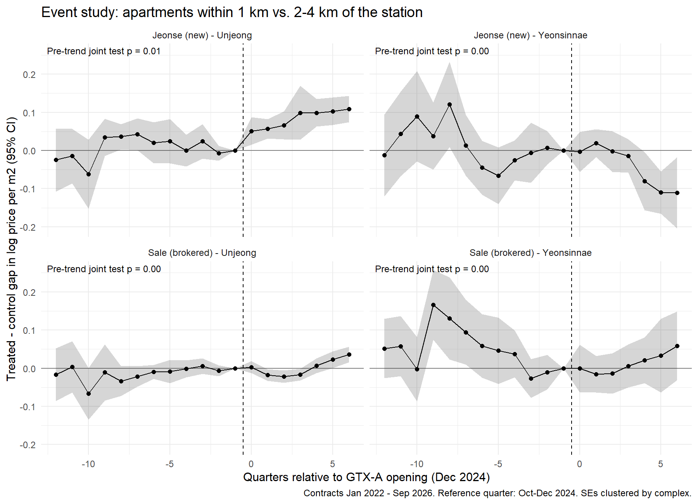

# Who Gains from a New Rail Line? Sale Prices vs. Jeonse Deposits around GTX-A

Author: Dahye Jeong, B.A. Urban Administration & Economics, University of Seoul
Last updated: November 2026, R 4.6.2, Data extracted 2026-11-12

This is a short, reproducible empirical exercise using public Korean transaction data. I built the dataset from the raw government APIs, estimated a difference-in-differences design, tested its assumptions, and report what does and does not hold up.


## Summary

On December 28, 2024, the GTX-A express rail line opened between Unjeong Jungang (Paju) and Seoul Station. I compare apartments within 1 km of two new stations with apartments 2-4 km away in the same district.

The one estimate that holds up is a 7-8% relative increase in deposits on new jeonse (lump-sum lease) contracts within 1 km of Unjeong Jungang. It holds up under a wild cluster bootstrap and a permutation test with 14 treated complexes, a later sample start, a wider radius, dropping any single complex, and a placebo date. It falls to about 4% when I allow a treated-specific linear trend.

I find no robust effect on sale prices. The second station, Yeonsinnae in Seoul, fails a placebo test, so I do not interpret its estimates.

## Question

Did the opening raise apartment sale prices, jeonse deposits, or both? I look at two stations on the same segment that differ in prior rail access. Unjeong Jungang is in a new town with no previous subway service, while Yeonsinnae was already served by Seoul Metro Lines 3 and 6.

## Data

| Source | Content |
|---|---|
| MOLIT apartment sale transactions, detailed (data.go.kr API) | Price, floor area, floor, building, contract date, cancellation flag, brokered vs. direct |
| MOLIT apartment lease transactions (data.go.kr API) | Deposit, monthly rent, new vs. renewal contract, use of statutory renewal right |
| VWorld Geocoder API | Coordinates of each apartment complex (parcel address) |

The sample covers Eunpyeong-gu (Seoul) and Paju-si, with contracts from January 2022 to September 2026. I extracted the data on 2026-11-12. Contracts can be reported up to 30 days after signing, so I drop October-November 2026 as incomplete.

### Sample construction ([`output/sample_flow.csv`](output/sample_flow.csv))

| Step | Sales | Leases |
|---|---|---|
| Raw records | 28,694 | 131,005 |
| Drop cancelled sales / keep pure jeonse (monthly rent = 0) | 27,254 | 61,027 |
| Keep contracts through Sep 2026 | 26,569 | 60,100 |
| Drop exact duplicate sales (same building, floor, area, price, date) | 26,187 | n/a |
| Main sample: brokered sales / new jeonse contracts | 24,484 | 34,025 |

I exclude direct (non-brokered) sales from the main specification because they often involve related parties. I classify each lease as new (34,025), renewal with the statutory renewal right exercised (10,057), renewal without it (9,422), or unrecorded (6,596). 785 of 788 complexes were geocoded. Complex IDs (`aptSeq`) begin with the district code, so they are unique across districts.

## Method

Difference-in-differences, estimated separately within each district:

```
log(y_ict) = b * Treated_i * Post_t + g1 * log(area_ict) + g2 * floor_ict + a_i + d_t + e_ict
```

- y: sale price or jeonse deposit per m².
- Treated: complexes within 1 km of the GTX-A station.
- Control: complexes 2-4 km away. I exclude complexes 1-2 km away.
- Post: contracts from January 2025.
- Fixed effects: a_i is a complex fixed effect and d_t is a contract-month fixed effect.
- Standard errors: clustered by complex.

I estimate the districts separately because local markets differ. In October 2025, Seoul, but not Paju, was designated a land-transaction permit zone. The event study replaces Treated x Post with quarter-by-treatment interactions, using Oct-Dec 2024 as the reference quarter.

## Results

### Main estimates ([`output/did_main.csv`](output/did_main.csv))

| Station | Outcome | Estimate | SE | 95% CI | % change | N | Treated / control complexes |
|---|---|---|---|---|---|---|---|
| Unjeong Jungang | New jeonse deposit | 0.078 | 0.015 | [0.049, 0.107] | +8.1% | 8,764 | 14 / 33 |
| Unjeong Jungang | Sale price (brokered) | 0.015 | 0.012 | [-0.009, 0.039] | +1.5% | 6,492 | 9 / 31 |
| Yeonsinnae | New jeonse deposit | -0.044 | 0.035 | [-0.113, 0.025] | -4.3% | 8,512 | 62 / 165 |
| Yeonsinnae | Sale price (brokered) | -0.014 | 0.024 | [-0.061, 0.033] | -1.4% | 5,181 | 44 / 162 |

Coefficients on Treated x Post, with standard errors clustered by complex.

Other contract types at Unjeong Jungang ([`output/did_secondary.csv`](output/did_secondary.csv)):

| Contract type | Estimate | SE |
|---|---|---|
| All jeonse | 0.058 | 0.011 |
| Renewals with the renewal right exercised | 0.043 | 0.012 |
| Renewals without it | 0.028 | 0.014 |

Increases on renewals in which the tenant exercises the statutory renewal right are legally capped. I report renewals separately as institutional context, but I do not attribute differences between contract types to the cap.

### Event study



Pre-trend tests:
- Over the full pre-period, joint tests that all 11 pre-opening coefficients are zero reject in every specification ([`output/pretrend_tests.csv`](output/pretrend_tests.csv)).
- For Unjeong jeonse, the rejection is driven mainly by the third quarter of 2022, during the interest-rate shock. With the sample starting in January 2023, the joint test no longer rejects (p = 0.105, 7 coefficients).
- The other three specifications still reject from 2023 onward ([`output/pretrend_tests_2023.csv`](output/pretrend_tests_2023.csv)).
- A non-rejection does not establish parallel trends, especially with few treated clusters.

Transactions per quarter behind each estimate are shown in [`output/event_study_counts.png`](output/event_study_counts.png).

### Robustness ([`output/robustness.csv`](output/robustness.csv))

I check the Unjeong jeonse estimate in four ways.

1. Inference with few treated complexes. Besides the conventional cluster-robust p-value, I report a restricted wild cluster bootstrap (Webb weights, 999 draws). I also run a permutation test that reassigns treated status across the 47 complexes while keeping 14 treated. Treatment is set by distance to the station, not at random, so the permutation test assumes the complexes are exchangeable and is a sensitivity check rather than design-based inference. Monte Carlo p-values use (1 + count) / (B + 1), so the smallest attainable value with 999 draws is 0.001.
2. Sample period and pre-trends. I start the sample in January 2023 and, separately, add a treated-specific linear time trend.
3. Treatment radius. I move the radius to 500 m and 1.5 km, keeping the control group at 2-4 km.
4. Influential complexes and placebo timing. I drop each of the 14 treated complexes in turn, keeping all control complexes, and I assign a placebo opening date of July 2023 using only contracts before October 2024.

New jeonse deposits at Unjeong Jungang:

| Check | Estimate | SE | p-value |
|---|---|---|---|
| Baseline, conventional cluster-robust | 0.078 | 0.015 | < 0.001 |
| Baseline, restricted wild cluster bootstrap | | | 0.003 |
| Baseline, permutation test (exchangeability) | | | 0.001 |
| Sample from January 2023 | 0.066 | 0.008 | < 0.001 |
| Treated-specific linear time trend | 0.038 | 0.018 | 0.045 |
| Treatment radius 1.5 km (28 treated complexes) | 0.053 | 0.015 | 0.001 |
| Treatment radius 500 m | n/a | n/a | not estimable: only 2 treated complexes |
| Placebo opening July 2023 (pre-opening data only) | 0.003 | 0.020 | 0.875 |
| Leave one treated complex out (14 estimates) | range 0.062 - 0.084 | | |

The leave-one-out exercise is run separately for new jeonse and for brokered sales. For sales the 9 estimates range from 0.007 to 0.022.

For sale prices at Unjeong Jungang, the baseline estimate is not significant (wild bootstrap p = 0.27, permutation p = 0.26), turns negative with a treated-specific trend (-0.027, p = 0.005), and the placebo is marginal (0.027, p = 0.088). The late rise in the event study is better explained by a pre-existing upward trend than by the opening.

At Yeonsinnae, the placebo test fails for both sales (-0.076, p < 0.001) and jeonse (-0.075, p = 0.001), so treated and control complexes were already diverging. The negative jeonse estimate disappears when the sample ends in September 2025, before the permit-zone designation (0.001, SE 0.031), which leaves nine post-opening months.

## Interpretation

Within Paju, deposits on new jeonse contracts near the new station rose by roughly 7-8% relative to comparable complexes 2-4 km away after the line opened. The estimate is stable across inference methods for few clusters, dropping 2022, a wider radius, dropping any single complex, and a placebo date. But it falls from about 8% to 4% once a treated-specific linear trend is allowed, and the full-period pre-trend test rejects. Together these limit how strongly the estimate can be read as causal. A cautious reading is an effect of roughly 4-8% on renters' prices.

I find no robust evidence that sale prices responded within the first 21 months. One possible explanation is that rents reflect current use value immediately, while sale prices had already absorbed expectations before opening. This explanation is a hypothesis, not something these estimates test.

The two stations cannot be compared to infer the role of commute-time savings. The Yeonsinnae design fails its placebo test, and the districts differ in many other respects.

## Limitations

- Few treated clusters at Unjeong Jungang: 14 complexes for jeonse and 9 for sales. The wild bootstrap and permutation test help but do not fully resolve this.
- Parallel trends: they are rejected over the full pre-period, and the jeonse estimate falls under a linear-trend specification.
- Spillovers: control complexes can reach GTX-A by bus, which would bias estimates toward zero.
- Composition: complex fixed effects absorb level differences, but changes in which units transact within a complex are not controlled.
- Short post-period: 21 months.

Natural extensions:
- Use all GTX-A stations with staggered openings, for example Dongtan in March 2024, together with modern staggered-DiD estimators.
- Measure station-level commute-time savings directly.
- Study the jeonse-to-monthly-rent conversion margin.

## How to reproduce

1. Install the packages:
```r
install.packages(c("httr2", "xml2", "dplyr", "purrr", "readr", "lubridate",
                   "sf", "fixest", "ggplot2", "usethis"))
```

2. Get two free API keys and store them in `~/.Renviron` (run `usethis::edit_r_environ()`):
```
DATA_GO_KR_KEY=your_data.go.kr_key
VWORLD_KEY=your_vworld_geocoder_key
```

3. Run the scripts in order:

| Script | What it does |
|---|---|
| `01_download.R` | Downloads monthly sale and lease records via the MOLIT API |
| `02a_clean.R` | Cleans transactions, classifies contracts, logs the sample flow |
| `02b_geocode_merge.R` | Geocodes complexes, computes distance to each station, assigns groups |
| `03_analysis.R` | Main DiD, event study, pre-trend tests, maps |
| `04_robustness.R` | Wild bootstrap, permutation test, leave-one-out, alternative samples, radius, placebo |

- Package versions are recorded in [`output/session_info.txt`](output/session_info.txt).
- Raw and intermediate data are not included. The scripts rebuild them.
- Re-downloading on a later date can change the most recent months as late reports arrive.

## Data notice

- Transaction data: Ministry of Land, Infrastructure and Transport (MOLIT), via the Public Data Portal (data.go.kr).
- Coordinates were obtained via the VWorld (공간정보 오픈플랫폼) Geocoder API. Under its terms of use, geocoded coordinates are not redistributed here.
